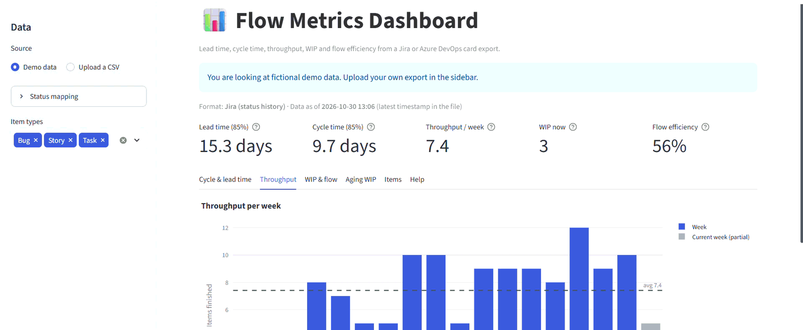
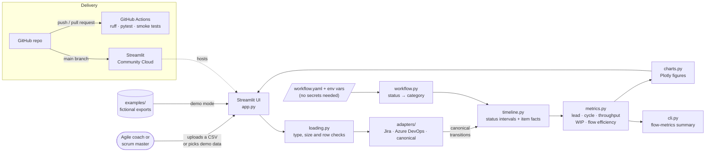

# 📊 Flow Metrics Dashboard

[](https://github.com/rafauto/flow-metrics-dashboard/actions/workflows/ci.yml)

[](LICENSE)

[](https://flow-metrics-dashboard.streamlit.app)

A Streamlit dashboard that turns a Jira or Azure DevOps card export into flow metrics: lead time, cycle time, throughput, WIP and flow efficiency. Upload a CSV, map your statuses once, and get the percentiles and charts a team needs to answer "when will it be done?" with data.

**Live demo:** https://flow-metrics-dashboard.streamlit.app (opens with fictional demo data, no sign-up)



## Why I built this

Teams that run Scrum or Kanban are often asked "when will it be done?" and answer with estimates, because the data that would answer it, the history of every card on the board, is locked inside the tool. Jira and Azure DevOps show some of these charts, but each in its own way, behind plugins or with definitions you cannot inspect.

I wanted a small, transparent tool that reads a plain export from either tool, applies one documented set of definitions, and shows the metrics that flow-based teams use to forecast and improve. Building it was also how I learned the topic properly: every definition is written down in [docs/metrics.md](docs/metrics.md) and checked by tests with hand-calculated values.

## Features

- **Reads three formats** and detects them by their columns: Jira status history, Azure DevOps revisions and a simple canonical format.
- **Status mapping in the sidebar**: each status is placed in *backlog*, *active*, *waiting* or *done*, with sensible defaults for common names.
- **Five KPIs**: lead time and cycle time (85th percentile), weekly throughput, current WIP and flow efficiency.
- **Charts**: cycle time scatter with p50/p85/p95 lines, lead time histogram, weekly throughput, daily WIP, cumulative flow diagram and aging WIP.
- **Filters by item type** (Story, Bug, Task…).
- **Per-item table** with every computed value, downloadable as CSV.
- **Demo mode** with a fictional team, so the app works without any upload.
- **Command line** (`flow-metrics summary`) for the same numbers without the UI.
- **Privacy by design**: titles and names are not needed; uploads are processed in memory and never stored.

## Example output / Results

Running the CLI on the bundled fictional Jira export (140 cards over 18 weeks):

```text
$ flow-metrics summary examples/sample_jira_export.csv
Format detected:    Jira (status history)
Data as of:         2026-10-30 13:06
Items:              140 (131 done)
Lead time  p50/p85: 9.7 days / 15.3 days
Cycle time p50/p85: 5.2 days / 9.7 days (p95 13.6 days)
Throughput:         7.4 items per week (complete weeks)
WIP now:            3 items
Flow efficiency:    56%
```

How to read it: half of the items were finished within 5.2 days of being started, and 85% within 9.7 days, so "about 10 days" is a defensible answer to "when will this new item be done?". The three sample formats (Jira, Azure DevOps and canonical) hold the same fictional board and produce identical numbers; a test checks this.

## Tech stack

| Area | Tools |
|---|---|
| Language | Python 3.10+ |
| Data processing | pandas |
| UI | Streamlit |
| Charts | Plotly |
| Configuration | YAML (status mapping), environment variables |
| Quality | Ruff (lint and format), pytest, Streamlit `AppTest` |
| CI/CD | GitHub Actions, Dependabot, Streamlit Community Cloud |
| Dev environment | venv or Dev Container |

## Architecture / How it works



The uploaded CSV is validated, then an adapter converts it into one canonical table of status changes. `timeline.py` turns those changes into periods spent in each status, and `metrics.py` computes every metric from those periods, so all three formats share the same logic. The UI only displays results; no data leaves the app and nothing is stored. (Source: [docs/architecture.mmd](docs/architecture.mmd), image: [docs/architecture.png](docs/architecture.png).)

**Key design decisions** (details in [docs/decisions/](docs/decisions/)):

- **One canonical format plus adapters** ([ADR 0001](docs/decisions/0001-canonical-transitions-format.md)): supporting a new tool means writing one small adapter, not touching the metrics.
- **Explicit metric definitions** ([ADR 0002](docs/decisions/0002-metric-definitions.md)): calendar days, percentiles of observed values, the commitment point is the first move to *active* or *waiting*, and "now" is the latest timestamp in the file, so results are reproducible.
- **Streamlit + Plotly, deployed without packaging** ([ADR 0003](docs/decisions/0003-streamlit-plotly-and-deploy.md)): the fastest path to a shareable demo, with the business logic kept in a plain Python package that does not depend on Streamlit.

## Project structure

```text
flow-metrics-dashboard/
├── app.py                    # Streamlit UI (presentation only)
├── src/flow_metrics/         # business logic, no Streamlit imports
│   ├── adapters/             # Jira, Azure DevOps and canonical formats → transitions
│   ├── loading.py            # CSV validation (type, size, rows, encoding)
│   ├── workflow.py           # status → category mapping
│   ├── default_workflow.yaml # default mapping for common status names
│   ├── timeline.py           # transitions → status intervals and per-item facts
│   ├── metrics.py            # lead/cycle time, throughput, WIP, CFD, flow efficiency
│   ├── charts.py             # Plotly figures
│   ├── sample_data.py        # fictional data generator (fixed seed)
│   ├── config.py             # settings from environment variables
│   └── cli.py                # `flow-metrics` command
├── tests/                    # unit, integration and smoke tests (offline, ~5 s)
├── examples/                 # fictional sample exports in all three formats
├── docs/                     # metrics guide, ADRs, product brief, backlog, operations
├── .github/                  # CI workflow, Dependabot, issue and PR templates
├── .devcontainer/            # reproducible dev environment
├── .streamlit/config.toml    # upload limit and theme
├── pyproject.toml            # package metadata, dependencies, Ruff and pytest config
└── requirements.txt          # used only by Streamlit Community Cloud
```

## Getting started

**Prerequisites:** Python 3.10 or newer and Git. No API keys are needed.

```bash
git clone https://github.com/rafauto/flow-metrics-dashboard.git
cd flow-metrics-dashboard
python -m venv .venv
source .venv/bin/activate          # Windows: .venv\Scripts\activate
pip install -e ".[dev]"
cp .env.example .env               # optional: only to change the defaults
streamlit run app.py
```

The app opens at http://localhost:8501 with demo data. Prefer containers? Open the folder in VS Code and choose **Reopen in Container**; the Dev Container installs everything.

**Development-only settings** (all optional, see [.env.example](.env.example)): `FLOW_METRICS_MAX_UPLOAD_MB`, `FLOW_METRICS_MAX_ROWS`, `FLOW_METRICS_WORKFLOW_FILE` and `FLOW_METRICS_LOG_LEVEL`. The same variables work in production.

## Usage

**In the app**

1. Pick **Demo data** to explore, or **Upload a CSV** and choose your export.
2. Open **Status mapping** in the sidebar and check that each status sits in the right category. New statuses are flagged.
3. Filter by item type if needed, then read the KPIs and browse the tabs. The **Help** tab explains every metric.

**Exporting your data**

| Tool | Columns the app needs |
|---|---|
| Jira (status history) | `Issue key, Issue Type, Status, Created, From Status, To Status, Status Changed` |
| Azure DevOps (revisions) | `ID, Work Item Type, State, Created Date, Changed Date` |
| Canonical | `item_id, item_type, created_at, from_status, to_status, changed_at` |

A standard Jira or Azure DevOps CSV only has the *current* status, so you need the status history: in Jira via the changelog (REST API or a history export app), in Azure DevOps via an Analytics view or OData query on `WorkItemRevisions`. Extra columns are ignored, and `;` delimiters from Excel work. Dates in ISO format (`2026-03-15 14:30`) are safest. The sample files in [examples/](examples/) show each format.

**From the command line**

```bash
flow-metrics summary my_export.csv                       # print the summary
flow-metrics summary my_export.csv --export items.csv    # also save per-item metrics
flow-metrics summary my_export.csv --workflow my.yaml    # use a custom status mapping
flow-metrics sample --output-dir examples                # regenerate the sample files
```

## Running the tests

```bash
ruff check .            # lint
ruff format --check .   # formatting
pytest                  # unit, integration and smoke tests, offline, ~5 seconds
```

The metric tests use a five-card board whose values were calculated by hand ([tests/conftest.py](tests/conftest.py)). The smoke tests run the full Streamlit app in demo mode with `AppTest` and the CLI end to end.

## Deployment

The demo runs on [Streamlit Community Cloud](https://streamlit.io/cloud) from the `main` branch, which only receives code through pull requests with a green CI.

To publish your own copy:

1. Fork this repository.
2. Sign in to Streamlit Community Cloud with GitHub and click **Create app**.
3. Choose the fork, branch `main` and main file `app.py`. Python 3.12 is recommended.
4. Optionally set the variables from `.env.example` under **Advanced settings → Secrets**. None are required.
5. Deploy. Every push to `main` redeploys automatically.

Rollback and troubleshooting steps are in [docs/operations.md](docs/operations.md).

## Project status and roadmap

**Status:** MVP (v0.1.0). The main flow works end to end with demo data and uploads.

- [x] Jira, Azure DevOps and canonical adapters
- [x] Lead time, cycle time, throughput, WIP, CFD, aging WIP and flow efficiency
- [x] Status mapping and item type filter
- [x] CLI, tests and CI
- [ ] Validate with agile practitioners and act on their feedback
- [ ] Date range filter for the analysis window
- [ ] Monte Carlo forecast: "how many items by date X?" and "when will these N items be done?"
- [ ] Business-day durations as an option
- [ ] Day-first date parsing option (for exports like 15/03/2026)
- [ ] PDF or HTML report export

## Limitations / Privacy

- **All bundled data is fictional**, generated by `flow-metrics sample` with a fixed seed. It does not describe any real team or company.
- **Uploads stay in memory** for your session and are never written to disk or sent to third parties. The app does not need titles, descriptions or people's names, so remove them before uploading; never upload data you are not allowed to share.
- Durations are **calendar days**, including weekends and holidays.
- "Now" is the **latest timestamp in the file**, not today's date, so an old export shows the metrics as they were then.
- Items finished without ever being in an *active* or *waiting* status have a lead time but no cycle time.
- Limits: 10 MB and 200,000 rows per file (configurable). The public demo runs on free hosting and may sleep when idle.

## Contributing

Contributions are welcome. Please read [CONTRIBUTING.md](CONTRIBUTING.md) for the setup, the checks to run before a pull request and the commit convention.

## License

[MIT](LICENSE) © 2026 Rafaela Uto

## Author

**Rafaela Uto** · Product Owner working on digital products, data and generative AI
[GitHub](https://github.com/rafauto)
